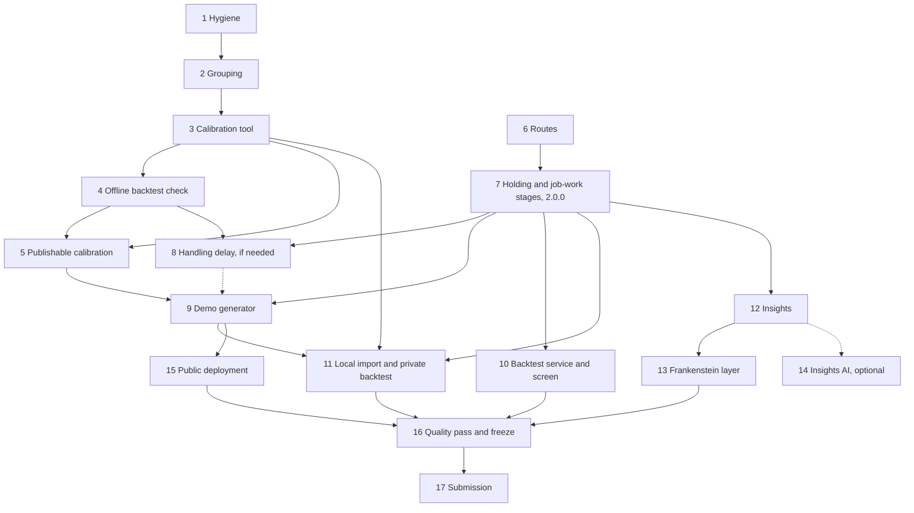

# Implementation Plan: Real-Factory Calibration and Kiroween Release

## Overview

Milestone: **M9 — Kiroween release**. Category **Frankenstein**. Code freeze **28 November 2026**; media
and submission 29 November to 3 December; deadline 4 December, 2 PM PT.

Scope for this release: **factory A only**. Factory B's October data is extracted locally but its department
grouping is unconfirmed; it is deferred and the docs say so.

Each task names its files, its test, and what "done" means, so it can be picked up cold. Planned on Fable;
executed on Opus. Order matters: a task lists what it depends on.

## Task Dependency Graph

Tasks 3–5 (measure) and 6–7 (engine) run in parallel; everything else waits for 7.

## Tasks

### A. Setup (16 November)

- [x] 1. Release hygiene and data safety
  - MIT licence; `.gitignore` for `local/`, `*.cnf`, `*.calibration.json`; client-data rule in `tech.md`.
  - _Requirements: 1.1, 7.1_

- [x] 2. Factory A stage grouping (owner confirms)
  - Draft is in `design.md`. Owner confirms or corrects: the checking department under Planning; the central
    stock department with Laser Cutting; the manufacturing service and machine departments as one Manufacturing stage.
  - Output: `local/factory-a.grouping.json` `{deptId: {stage, kind}}` with kinds `INWARD`, `PARKING`,
    `WORKING`, `JOB_WORK`, `DISPATCH_WAIT`, `END`. Local only.
  - Done when the owner has said yes to every row.
  - _Requirements: 1.2_

### B. Measure (16–18 November)

- [x] 3. Calibration tool `tools/calibration/` (Python)
  - Depends on 2. Reads the October extracts already on disk (`history`, `movements`, `worker_moves`,
    `route_movements`, `dispatched_with_root`); later also live, read-only, via `TRYBE_DB_CNF`.
  - Refuses any statement that is not `SELECT`/`SHOW`; writes only under `local/`.
  - Computes, per route (packet type) and per stage: arrivals; dwell deciles (working seconds, using the
    factory calendar); time-with-worker deciles; workers active per day; packets per worker per day;
    weight yield per process (issued vs returned); parking rate and parking deciles; dispatch-wait deciles;
    job-work deciles; batches per lot; lead time with and without parking.
  - Output: `local/factory-a.calibration.json` (detailed, with stage names) and a route table.
  - Test: `tools/calibration/tests/` on a 200-row hand-made fixture with known answers; no real data.
  - Done when the tool reproduces the figures already found by hand (lead 19.8 / 15.0 days; parking 47%,
    median 9.5 days; TOPS 5.6 days; recut loss 16%) within rounding.
  - _Requirements: 1.1, 1.3_

- [x] 4. Offline backtest check (decides the engine design)
  - Depends on 3. A throwaway Python simulation (not the Java engine): fork 1 October, replay factory A's
    real arrivals through the calibrated stages with worker capacity only, and compare October dispatches,
    median lead time and per-stage WIP with what was recorded.
  - Decision recorded in `design.md`: whether working stages need a calibrated handling delay on top of
    capacity queuing. Threshold: dispatches and median lead time within 20% without it → not added.
  - Output: rounded error table in `local/`; the decision in the repo.
  - _Requirements: 4.1, 4.2_

- [x] 5. Publishable calibration
  - Depends on 3 and 4. `tools/calibration/publish.py` merges and rounds (deciles to whole hours, rates to
    5%, counts to tens), replaces stage names with generic ones (Intake, Imaging, Planning, Sawing, Recut,
    Bruting, Polishing, Inspection, Lab, Dispatch), drops every identifier →
    `backend/src/main/resources/demo/calibration.json`.
  - Test: `CalibrationFileTest` checks structure and, when `local/names.txt` exists, that no name in it
    appears in the file; in CI the names file is absent.
  - _Requirements: 1.4_

### C. Engine (18–21 November)

- [x] 6. Routes per packet type
  - Depends on nothing; can start in parallel with B.
  - Snapshot: `RouteSnapshot(code, List<UUID> stageIds)` in `Snapshot`; `BatchSnapshot` gains `routeCode`
    (nullable: implicit route over all stages). `SnapshotJson` canonical form updated; schemaVersion 2.
  - Engine: `SimulationInput` gains `routes`; `ProductionJob` carries a route index instead of a bare
    stage index; `SimulationEngine.java:199` becomes "next stage on this batch's route". `InputValidator`
    checks every route stage exists and every batch's route exists.
  - Workflow API: `POST /api/workflows/{id}/routes` and stage `kind` (task 7) are **not** exposed for editing
    in this release; routes come from the seed or an import.
  - Test: `RouteTest` unit tests; jqwik property: a snapshot with one implicit route produces output
    identical to the current engine (golden file from 1.0.0).
  - _Requirements: 2.1, 2.5_

- [x] 7. Holding and job-work stages; algorithm 2.0.0
  - Depends on 6. Migration `V9__stage_kind.sql`: `workflow_stage.kind` (`WORKING` default, `HOLDING`,
    `JOB_WORK`) and `delay_deciles` jsonb (nullable). `StageSnapshot` gains both.
  - Engine: a `HOLDING`/`JOB_WORK` job skips scheduling and completes at `arrival + decile[hash(batchId) % 10]`
    working seconds (calendar-aware); no pool allocation, no cost. Metrics: `holdingSeconds`,
    `jobWorkSeconds`, `manufacturingLeadSeconds` (elapsed minus holding) in `SimulationMetricsCalculator`,
    result tables (`V9`), `RunResultsPort.SummaryView`, `MetricCatalog`, AI evidence keys.
  - `SimulationEngine.ALGORITHM_VERSION = "2.0.0"`. `storedResultsAreServedUnchangedUnderTheVersionThat
    ProducedThem` must still pass; `reExecutingAStoredSnapshotReproducesTheStoredSummary` gets a 2.0.0 case.
  - Test: determinism (same input twice); holding time excluded from manufacturing lead; a 1.0.0-shaped
    input gives 1.0.0 output; ArchUnit unchanged.
  - _Requirements: 2.2, 2.3, 2.4, 2.5_

- [x] 8. Handling delay on working stages (only if task 4 says so)
  - Depends on 4 and 7. Same decile mechanism, applied after processing at a `WORKING` stage; stored as
    `handling_deciles` on the stage. Scenario changes to capacity do not change it; the docs say why.
  - Test: as 7.
  - _Requirements: 2.2_

### D. Demonstration (21–23 November)

- [x] 9. Calibrated demo generator and new demo factory
  - Depends on 5 and 7 (and 8 if taken). `demo.CalibratedDemoGenerator` reads `demo/calibration.json`
    and a fixed seed; replaces `WorkflowSeedSection`, `ResourceSeedSection`, `ProductionSeedSection` and
    `ScenarioSeedSection` content (keep the section mechanism and `DemoSeedContext` ids).
  - Factory stays "Surat Diamond Works" (fictional); baseline scenario stays "Current factory operations"
    (frontend fixtures and the e2e journey depend on these names). Stages: about 12 with generic names,
    3 routes, a Parking stage, a Dispatch-wait stage, 2 job-work stages; pools are worker pools; about 60
    lots / 150 packets over 3 weeks of history; seeding must stay under 40 s.
  - Scenarios: "Current factory operations"; "Three more inspectors"; "Dispatch twice a day"; "Park half as
    long"; "Cutting job worker 30% slower"; "Introduce an additional shift".
  - Test: `DemoIT` digest equality on reseed; `DemoCalibrationIT`: simulated baseline median lead time with
    and without parking within ±15% of `calibration.json`; `DemoScenariosIT` and the e2e journey updated
    (pool option label changes from "Polishing wheels (6)").
  - Docs: `docs/demo-data.md` rewritten.
  - _Requirements: 3.1, 3.2, 3.3_

### E. Accuracy (22–25 November)

- [x] 10. Backtest service, API and screen
  - Depends on 7. `simulation.backtest.BacktestService`: for each fork date, snapshot with no changes,
    run, compare over [fork, min(simulated end, last recorded event)] using `ActualOutcomeService` and
    `FactoryStateService` per-stage WIP at the comparison end. Stored in `backtest` and `backtest_fork`
    tables (`V10`); `POST /api/backtests {factoryId, forkAts[]}`, `GET /api/backtests/{id}`.
  - Screen "Accuracy" (`features/accuracy/`): per fork, predicted vs recorded with error %, overall median
    absolute error; tagged Simulated vs Actual; table for every chart.
  - Test: `BacktestIT` on the demo factory (errors are finite and the window is cut at the last event);
    component test with a captured fixture.
  - _Requirements: 4.1, 4.2, 4.3_

- [ ] 11. Local import of factory A and private backtest
  - Depends on 3, 7, 9. `tools/import/` (Python) writes factory A, anonymised, into a **local** RealityCheck
    database through the public API: stages from the grouping, worker pools from workers-per-day, lots as
    orders, packets as batches, movements as events. Names → codes (`D01`, `W017`, `L0042`).
  - Run backtests for forks 1, 8, 15, 22 October; record rounded errors (no dates) in
    `docs/accuracy.md`; the detailed results stay in `local/`.
  - Test: importer against a 200-row fake database fixture only; a test asserts no string from
    `local/names.txt` reaches the API when that file exists.
  - _Requirements: 1.1, 4.1, 4.4_

### F. Value and theme (25–27 November)

- [x] 12. Insights: where time goes
  - Depends on 7. `production.insights.InsightsService` over recorded events: lead time with/without
    parking by route; per stage working vs waiting; workers per day; yield per stage; dispatch wait.
    `GET /api/factories/{id}/insights`. Screen `features/insights/` with tables for every chart, tagged
    Actual; nav entry "Where Time Goes".
  - Test: service against a hand-computed fixture; component test; accessibility suite.
  - _Requirements: 5.1, 5.2_

- [x] 13. Frankenstein layer
  - Ghost futures: on Simulation Results, the alternative's order completions drawn translucent over the
    recorded/baseline timeline (extend `ProductionTimeline`). Haunted stages: on Workflow, stages ranked by
    waiting share from Insights, marked with the same evidence as the bottleneck card. Halloween theme as a
    second token set under `:root[data-theme="halloween"]`, contrast ≥ 4.5:1, toggle in Settings,
    professional default. README: the stitched parts and the Kiro story.
  - Test: component tests; accessibility suite run in both themes.
  - _Requirements: 6.1, 6.2, 6.3, 6.4_

- [ ] 14. (Optional) Analyst explains Insights
  - Evidence keys `insight.*`; same validator; one insight type `TIME_LOSS_SUMMARY`.
  - _Requirements: 5.1_

### G. Release (26–28 November)

- [ ] 15. Public deployment
  - One small VPS, Docker Compose, Caddy for HTTPS, `REALITYCHECK_DEMO_RESET_ENABLED=false`, nightly cron
    calling the reset through a local-only admin port; `AI_DAILY_BUDGET_USD` (new property; counts tokens
    stored on insights; template answers once exceeded). Owner decides whether Claude is on.
  - Test: `AiBudgetTest`; the e2e journey run against the public URL.
  - _Requirements: 7.2, 7.3_

- [ ] 16. Quality pass and code freeze (28 November)
  - All suites green; fresh-machine `docker compose up` check; `docs/accuracy.md`, `docs/method.md`
    (calibration, privacy, limits: factory A only, splitting as yield, repairs out of scope); Kiro usage
    write-up `docs/kiro.md`; spec notes.
  - _Requirements: 6.4, 7.1_

### H. Submission (29 November – 3 December)

- [ ] 17. Video under three minutes (script drafted by 27 November), screenshots, Devpost text, category,
  Kiro write-up; optional blog post and social post for the bonus prizes.
  - _Requirements: 7.4_

## Notes

Progress (16 November): grouping confirmed with one change, two named dispatch departments are both end
points (lead time stops on reaching either); the third dispatch department stays dispatch waiting. Calibration of factory A,
October 2026, 30,522 dispatched pieces: lead median 17.0 days, 11.4 without parking; parking 47% of pieces
and 39% of all lead time; routes vary widely within a packet type (the most common route covers 1–14% of
pieces), so the demo uses each type's most common route.

If time runs short, cut in this order: 14 (Insights AI), 12 (Insights screen; keep numbers in docs),
10 (backtest screen; keep numbers in docs), then the Halloween theme inside 13 (keep ghost futures).

Task 6 (17 November): routes are a pure addition. `SimulationInput.routes` and `BatchSpec.routeCode`
(convenience constructors keep every existing caller); each batch gets a path at the start (optional steps by
a SplitMix64 hash of batch id and stage); output is summed per finished batch at the end of its own path.
Snapshots: `routes` and `routeCode` are omitted from JSON when empty, so stored snapshots and their hashes are
unchanged and `SCHEMA_VERSION` stays 1; `Snapshot` and `BatchSnapshot` have no shortcut constructors, so the
scenario-change code carries routes explicitly. The demand change's "not yet started" uses the route's first
stage. Routes are not stored in the database yet: the assembler builds snapshots without them until task 9.
Tests: `RouteTest` (6), `SnapshotJsonTest` (2 new), a jqwik property over 1,000 random factories that a full
route over every stage equals no route.

Task 7 (17 November): stage kinds `WORKING`, `PARKING`, `WAITING`, `JOB_WORK` (`V9__stage_kind.sql`, with a
check that only holding kinds have delays). A holding stage holds each batch for one of its ten measured
delays in calendar time (measured that way: parking spans nights), chosen by the same SplitMix64 hash with a
different salt, so task 6's route choices are unchanged. Summary: `parkingSeconds`, `waitingStageSeconds`,
`jobWorkSeconds`, `batchLeadMedianSeconds`, `batchManufacturingMedianSeconds` (the lower middle value, so it
is a time some batch took); stored in the summary JSON, null for 1.0.0 runs. The comparison gains the two
medians (18 metrics). Algorithm 2.0.0. `WorkflowStage.holdFor` sets a holding kind (used by the seed in task
9); the stage API does not edit kinds in this release. Differs from the design: kinds are four, not three,
because parking (excluded from manufacturing lead time) and dispatch waiting (included) must be told apart.
Tests: `HoldingStageTest` (7), a snapshot round trip for kinds; every earlier test passes unchanged.

Task 8 (17 November): working stages may have ten handling durations (`V10__stage_handling.sql`, only for
working stages). Implemented as a second phase of the same job rather than a new event type, so event
ordering is untouched: processing completes (units released, output recorded, trace JOB_COMPLETED), then the
batch is held for its handling delay and only then moves on or finishes. The stage counts as active for the
bottleneck signals only while a job is processing; this also stops task 7's holding jobs from counting.
Summary `handlingSeconds`. Tests: `HandlingDelayTest` (5), including that utilization and every stage signal
are identical with and without handling.

Task 9 (17 November): `demo.CalibratedDemoGenerator` builds the factory from `calibration.json`: 11 stages
(one job-work stage and two routes, as the calibration has, rather than the 2 and 3 first planned), 8 worker
and 2 machine pools, rates set so each working stage runs at its measured typical load at ten packets a day,
handling delays from the measured stays. Per-stage stays do not add up to route lead times (they pool every
visit), so two factors were fitted (shared stages 0.55, polishing 3.0); Tops parks 41% so that 45% of all
packets do. `DemoCalibrationTest` (engine only, sixty days of packets) and `DemoCalibrationIT` (seeded
factory through the API) check the medians within 15%; measured 17.0 / 11.5 days, simulated 16.7 / 10.8.
Routes are stored on the workflow (`V11__routes.sql`, jsonb) with `production_batch.route_code`; the batch
history follows a batch's route (`BatchHistory.Stop`, optional steps may be skipped, `nextStageId` on a stage
completion), and snapshots carry routes. New change type `STAGE_DELAY` scales a stage's parking, waiting,
job-work or handling times, so the demo can ask "park half as long"; the stage API now returns `kind` and
the delays. Scenarios: as planned, except "Dispatch twice a day" (not expressible honestly as a delay
change) is replaced by the demand scenario, and "Cutting job worker" is "Job worker 30% slower". The seed
clears the persistence context every 200 writes; it takes about 32 s on Docker Desktop for Windows with the
machine otherwise idle (two to three times that under load). `BaselineSimulationIT` no longer expects
polishing to be the bottleneck: in the calibrated factory packets wait mostly for measured handling and
holding, so the test checks that the verdict and its evidence agree instead.

Task 13 (17 November): ghost futures are a card on the comparison (`GhostFutures`): each order's baseline
completion, the alternative's as a translucent ghost joined to it, and recorded completions as diamonds when
the comparison includes them; one sentence of derived counts above it, and the order delivery table as its
text equivalent. Haunted stages need recorded time per stage, which is the core of task 12, so that part was
built now: `InsightsService` and `GET /api/factories/{id}/insights` (waiting and worked or held time per
stage, idle share, `hauntedRank` for the three stages with the largest idle share of at least 5%); task 12
adds the rest of the screen on the same endpoint. The Workflow page shows a Haunted stages card and marks
those stages in the pipeline. Halloween theme: a second token set under `:root[data-theme="halloween"]`,
every listed text/background pair at least 6:1 (checked by script), chosen in Settings, remembered per
browser, applied before the first render; the accessibility suite runs it at 375 and 1440 px. README
rewritten around the stitched parts and the Kiro story. Verified on the rebuilt Docker stack: the demo reset
(seed) takes 32 s there, and all 62 browser tests pass (the journey, now also checking haunted stages and ghost
futures, and the accessibility suite in both themes).

Task 12 (18 November): the insights endpoint from task 13 now also returns lead times of finished packets
by route (lower median with and without parking, parking's share), recorded yields per stage over completed
visits, and the wait for dispatch; screen "Where Time Goes" (`features/insights/`) with a table for every
chart, all tagged Actual. Workers per day is not shown: recorded events do not say who did the work, and it
is not inferred. Finished packets understate parking in a short history (parked packets are mostly still
parked: 2% against 21% of all recorded packet time in the demo), so the headline shows parking over all
packet time and the finished-only share is labelled as such in the route table. Tests: `StageTimesTest`
(hand-worked yields and journeys), `DemoIT`, `InsightsPage.test.tsx`, accessibility suite (68 browser tests).

Task 10 (18 November): `simulation.backtest.BacktestService` builds the baseline snapshot at each date with later
orders included (the lots that really arrived arrive in the simulation too), runs the engine with no changes and
compares with recorded history over [date, min(simulated end, last recorded event)] for the same batches. The
engine result now lists each finished batch's finish time (`batchFinishes`; handling at the last stage makes the
trace alone insufficient); nothing stored changes. Recorded progress is read through the scenario module
(`RecordedProgressService`, over `FactoryStateService`), because simulation may not read production directly.
Lead time in a backtest runs from the date (or arrival) to finishing on both sides, not from first queueing.
Stored in `backtest` and `backtest_fork` (`V12__backtest.sql`; V10 was taken by task 8). With no dates given,
four are spread evenly over the history. Screen "Accuracy": typical error across dates, each date predicted
against recorded (chart and table), work in progress by stage for a chosen date. On the demo factory (4 dates,
about 4 s): packets finished 19%, median lead time 4%, work in progress 40% placed at the wrong stage, mostly
because the simulation queues packets at polishing that were recorded further on. The numbers are shown as
they are. Tests: `BacktestComparisonTest` (hand-worked), `BacktestIT` (window cut at the last event, errors
finite, stored as computed, a date outside history refused), `AccuracyPage.test.tsx` with a captured fixture,
the journey (step 13) and the accessibility suite.

Factory B: its October 2026 data is extracted locally and its draft grouping is in the conversation record,
but nothing from it is used in this release.

### Owner actions and dates

| By | Action |
|---|---|
| 17 Nov | Confirm factory A grouping (task 2) |
| 17 Nov | Rotate the factory A database password; a SELECT-only user if possible |
| 24 Nov | Decide: Claude on the public link (a few dollars, capped) or built-in analyst only |
| 26 Nov | VPS account and domain (or accept an IP-only link with a self-signed certificate) |
| 27 Nov | Review the video script |
| 29 Nov–3 Dec | Record the video; submit on Devpost |
