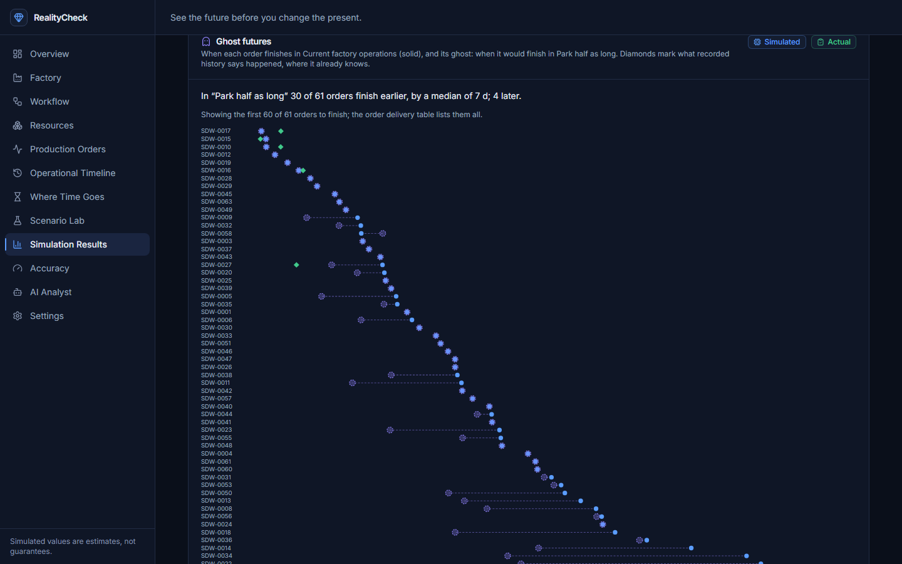

# RealityCheck

**See the future before you change the present.**

RealityCheck is an operational time machine for a factory. It replays what really happened, lets you stop at
any recorded moment, change a decision, and watch the other future play out beside the one that happened.
The first implementation is diamond manufacturing.

**Watch the 3-minute demo:** https://youtu.be/Rw4WrUri5G0



It is a Kiroween entry in the **Frankenstein** category: five parts that were never meant to live in one
body, stitched together so that each keeps its own nature.

## The creature

| Part | What it is | What it is never allowed to do |
|---|---|---|
| **The skeleton:** an append-only history | Every packet movement as an immutable event (PostgreSQL, a trigger refuses edits; mistakes are corrected by new rows). The factory can be rebuilt at any past instant. | Change the past |
| **The heart:** a deterministic engine | A discrete-event simulator in plain Java: calendars, worker and machine pools, routes, parking, outside job work, handling delays, yields, cost, bottleneck evidence. Same input and version, same result, to the second. | Guess, or use randomness |
| **The blood:** a real factory's patterns | A Python pipeline reads one real diamond factory's month of movements **on the owner's machine only**, and publishes rounded, nameless patterns (`calibration.json`). The demo factory is built from them and reproduces the measured lead times within 15%. | Publish a name, an identifier or a raw row |
| **The voice:** an AI analyst | Claude explains results, recommends and answers questions, given only the stored evidence. Every number it writes is checked against the stored results; an answer that fails is replaced by a built-in analyst. | Calculate a number |
| **The face:** a React app | Thirteen screens over the same API, every figure tagged Actual, Simulated or AI interpretation, with a table behind every chart. | Show a number without its source |

The stitches are contracts, not shared code: the engine sees only a frozen **snapshot** (versioned, hashed,
stored with each run); the analyst sees only **evidence keys** and its numbers are validated against them;
the real factory reaches the repository only as **rounded aggregates** that a script refuses to publish if
any real name appears.

### What only the creature can show

- **Ghost futures.** On a comparison, every order's simulated completion with its ghost: when it would have
  finished under the alternative decision, and, where history already knows, when it really did.
- **Haunted stages.** On the workflow, the stages where packets lose the most time without anyone working on
  them, ranked from every recorded visit.
- **Where Time Goes.** Lead time with and without parking, packet time per stage, yields and the wait for
  dispatch, all from recorded events.
- **Accuracy.** A backtest: the factory simulated from past dates with no changes and compared with what was
  recorded. On the demonstration factory seeded on 18 November, the typical error was 19% for packets
  finished, 4% for median lead time and 40% for work in progress by stage (the simulation holds too many
  packets at polishing), shown as measured; the demonstration is seeded relative to the day it starts, so the
  figures move with it. On one real factory's month, imported privately and compared over seven-day windows, it is 19%,
  44% and 64%: see [docs/accuracy.md](docs/accuracy.md).
- **The Halloween theme** (Settings, Appearance): same data and contrast guarantees, darker night.

### What the real data said

Calibrated on one factory's October 2026 (rounded): the median packet took 17 days from inward to dispatch,
but 11.5 without parking; parking was about two fifths of all lead time; and most departments held packets
for one to two days while running well below capacity. In the demonstration, "Park half as long" is
therefore a bigger lever than "Three more inspectors", and the simulation shows why. Simulated outcomes are
estimates under stated assumptions, not guarantees.

## How it was built with Kiro

- **Steering** ([.kiro/steering/](.kiro/steering/)): product rules (never fabricate a metric, AI never
  calculates), the technology and architecture boundaries, and the simulation rules the engine must obey.
- **Specs** ([.kiro/specs/](.kiro/specs/)): eleven features, each with requirements, a design and a task
  list, implemented task by task with progress notes; spec 11 is the real-factory calibration.
- **Hooks and agents** ([.kiro/hooks/](.kiro/hooks/), [.kiro/agents/](.kiro/agents/)): checks run on save
  (lint and type-check, module tests, API contract, architecture docs, simulation-engine review) and
  specialist agents for the engine, the database, the backend, the UI and testing. The full account is in
  [docs/kiro.md](docs/kiro.md).

## Principles

- **Numbers come from the simulation engine or from recorded history.** AI explains results; it never
  calculates them.
- **Demo data is calibrated, not real.** "Surat Diamond Works" is fictional. Its patterns come from rounded
  measurements of one real factory; every name and every other figure is synthetic. Client data never enters
  the repository ([docs/demo-data.md](docs/demo-data.md)).

## Status

| Milestone | Scope | State |
|---|---|---|
| 1. Foundation | Backend, frontend shell, PostgreSQL, Flyway, OpenAPI, health checks, Docker Compose, Kiro steering and specs | **Done** |
| 2. Factory configuration | Factory, workflow, stages, resource pools, requirements, demo seed | **Done** |
| 3. Production operations | Orders, batches, append-only events, timeline | **Done** |
| 4. Simulation engine | Discrete-event engine, calendar, yield, metrics, bottleneck detection | **Done** |
| 5. Scenario branching | Scenarios, changes, stored background runs, comparison | **Done** |
| 6. Frontend | The ten application screens | **Done** |
| 7. AI intelligence | Provider abstraction, evidence-checked explanations, Q&A, AI Analyst screen | **Done** |
| 8. Quality and deployment | End-to-end and accessibility suites, recorded outcome after a fork, demonstration guide | **Done** |
| 9. Real-factory calibration | Routes, parking and job-work stages, handling delays, calibrated demo, ghost futures, haunted stages, Where Time Goes, Accuracy, private backtest of a real factory, public deployment setup | **Done** (public server pending) |

**First time here?** Start it with the two commands below, then follow [docs/demo.md](docs/demo.md): a
fifteen-minute walkthrough of the operational time machine, from a recorded moment to a simulated decision
and the AI analyst's explanation.

## Bring your own data

**Import Data** takes two CSV files, exported from a production system or a spreadsheet:

- **orders**: one row per packet: `order_number, customer_ref, priority, placed_at, due_at, dispatched_at,
  packet, stones, carats, route`
- **movements**: one row per stage a packet visited: `order_number, packet, stage, started_at,
  completed_at, stones_out, carats_out`

The screen offers both templates and checks every row's format at once. **Check** then runs the whole import
through the same rules as live recording and undoes it, naming the file and row of any problem. **Import**
saves it all or nothing. Imported rows are recorded history like any other, so Where Time Goes, the
timeline, scenarios and backtests work on them straight away. The stages must exist in the active workflow.
For a continuous feed, a system can post the same rows to `POST /api/imports` ([docs/api.md](docs/api.md)).

## Run it with Docker

Requires Docker Desktop (or Docker Engine with Compose v2).

```bash
cp .env.example .env        # PowerShell: Copy-Item .env.example .env
docker compose up --build
```

| What | URL |
|---|---|
| Application | http://localhost:3000 |
| API documentation (Swagger UI) | http://localhost:8080/swagger-ui.html |
| Health | http://localhost:8080/actuator/health |
| System info | http://localhost:8080/api/system/info |

Ports are set in `.env`. The database is published on host port 15432, not 5432, so it does not collide with
a locally installed PostgreSQL. Stop with `docker compose down`; add `-v` to delete the database volume.

## Develop locally

See [docs/setup.md](docs/setup.md) for prerequisites, running the backend and frontend outside Docker, and
the test commands.

```bash
docker compose up -d db                 # database only
cd backend && ./mvnw spring-boot:run    # http://localhost:8080  (JDK 21+)
cd frontend && npm install && npm run dev   # http://localhost:5173
```

## Documentation

- [docs/demo.md](docs/demo.md): demonstration walkthrough, starting again, troubleshooting
- [docs/architecture.md](docs/architecture.md): modules, data flow, key decisions and their trade-offs
- [docs/setup.md](docs/setup.md): prerequisites, configuration, commands, troubleshooting
- [docs/api.md](docs/api.md): API conventions and every endpoint
- [docs/ai.md](docs/ai.md): the AI analyst: setup, cost, evidence checking, fallback
- [docs/deploy.md](docs/deploy.md): public deployment: one server, HTTPS, nightly reset, AI spending cap
- [docs/method.md](docs/method.md): how the real factory was measured, kept private, and what the model leaves out
- [docs/kiro.md](docs/kiro.md): how the steering, specs, hooks and agents in `.kiro/` shaped the build
- [docs/accuracy.md](docs/accuracy.md): backtests on the demonstration factory and on one real factory
- [docs/demo-data.md](docs/demo-data.md): the calibrated demonstration factory and how to reset it
- [.kiro/steering/](.kiro/steering/): product, technology, architecture and simulation rules
- [.kiro/specs/](.kiro/specs/): requirements, design and tasks for each feature

## Repository layout

```
backend/     Spring Boot 3 (Java 21) modular monolith
frontend/    React + TypeScript + Vite single-page application
docs/        Architecture, setup and API documentation
.kiro/       Kiro steering documents, specifications, hooks and agents
tools/       The calibration pipeline (Python); it runs on the data owner's machine
```

## Licence

MIT; see [LICENSE](LICENSE).
